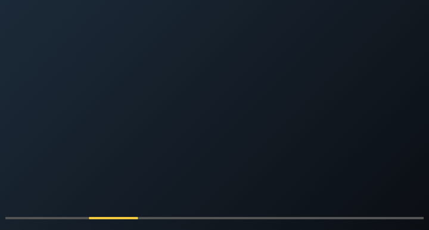

# Skipz

Skipz finds the sponsor part of a YouTube video and skips it for you. It asks first, unless you tell it not to.

It works on videos nobody has marked yet, including ones posted an hour ago. It reads what YouTube already shows (the paid-promotion label, the description, the chapters and the video's own captions) on your computer. Nothing leaves your browser. There is no account, no key and no server.

> **Status: beta.** Skipz can miss a sponsor or mark the wrong stretch. It asks before skipping unless you switch that off, and Undo is always one tap. Spotted a mistake? Open an issue: that is how it gets better.



## What you get

- **A yellow mark on the timeline** over the sponsor part.
- **A prompt a moment before it starts:** "Skip it?" with two big buttons. Undo is one press.
- **Three modes in the toolbar popup:** Ask me before skipping (the default), Don't ask me before skipping (it skips by itself), Don't skip.

## How it decides

Skipz combines these signs and marks a sponsor only when it is sure enough:

1. YouTube's own "includes paid promotion" label.
2. Sponsor lines and links in the description.
3. Chapters named after a brand.
4. Spoken ad reads in the video's captions ("this video is sponsored by …", a deal code, "link in the description").
5. No captions? If you agree, Skipz listens to the video on your computer with two small speech models and catches the sponsor read as it starts. It can then skip the rest of the read, one short jump at a time, and Undo takes you back.
6. The marks other viewers made on [SponsorBlock](https://sponsor.ajay.app), a free community project. Where viewers saw the ad, Skipz uses their times.

The rules are plain text patterns and a few thresholds. You can read them in [`src/detector/lib/sponsor/`](src/detector/lib/sponsor/). [How it works](docs/HOW-IT-WORKS.md) walks through one video.

## Privacy

Skipz asks Chrome for four things: `storage` (your mode and counters), `scripting` (to read the page you have open), `offscreen` (a hidden page that runs the listening models) and access to `youtube.com`. It sends nothing about you. For each video it asks SponsorBlock for the community's marks, and the question carries only the first four characters of a scrambled copy of the video's id, so SponsorBlock cannot tell what you watch. [Details](docs/PRIVACY.md).

## Install

Chrome Web Store: coming soon. Until then, from source:

```
git clone https://github.com/getskipz/skipz.git
cd skipz
npm install
npm run build
```

Then open `chrome://extensions`, switch on **Developer mode**, press **Load unpacked** and choose the `dist` folder.

**Firefox (desktop, and Android later):** `npm run build:firefox` writes `dist-firefox`. In Firefox open `about:debugging`, choose **This Firefox**, press **Load Temporary Add-on** and pick `dist-firefox/manifest.json`. It passes Mozilla's add-on checker with no errors or warnings. It also runs on the mobile site (`m.youtube.com`), which is what Firefox for Android opens. Not yet tested on a phone.

## Test it by hand: the best way to give back

A test suite cannot open YouTube on your phone. You can. A three-minute check on your own device, or on a video where Skipz got it wrong, improves Skipz for everyone, and it needs no code. Every report becomes a test that keeps the fix in place, and you are credited. **Nobody has run Skipz on a real phone yet: the first mobile testers matter most.** Start with [docs/TESTING.md](docs/TESTING.md).

## Help make it better

The most useful contribution takes two minutes: tell us about a video where Skipz was wrong.

- **A sponsor Skipz missed:** use the "Missed sponsor" issue form.
- **A mark in the wrong place, or a wrong skip:** use the "Wrong mark" form.
- **You can write code:** read [CONTRIBUTING.md](CONTRIBUTING.md). Every rule change needs a real example behind it, so each report you send becomes a test that keeps the fix in place.

Contributors are listed in [CONTRIBUTORS.md](CONTRIBUTORS.md) with the fix they made.

## Who runs this

Skipz is run by one person for now: Yx. I read every report. Replies can take a few days, and I will say so here if I am away. Skipz is not backed by a company, so the best thing you can do is test it and tell me what you find.

## Licence

[GNU General Public License, version 3 or later](LICENSE). Skipz is free to use, change and share under that licence: if you share a changed copy, you share its source under the same licence. The name Skipz and its logo are not part of the licence.

**Commercial licence.** If you want to use Skipz's code in a product that you do not want to release under the GPL, a separate commercial licence is available. Open an issue on this repository titled “Commercial licence”, say in a line how you would use Skipz and how to reach you, and I will reply. Please keep private details out of the issue.

The SponsorBlock data Skipz reads is made by its contributors under [CC BY-NC-SA 4.0](https://creativecommons.org/licenses/by-nc-sa/4.0/) and is not covered by this licence or the commercial one.

Skipz is not affiliated with or endorsed by YouTube or Google.
